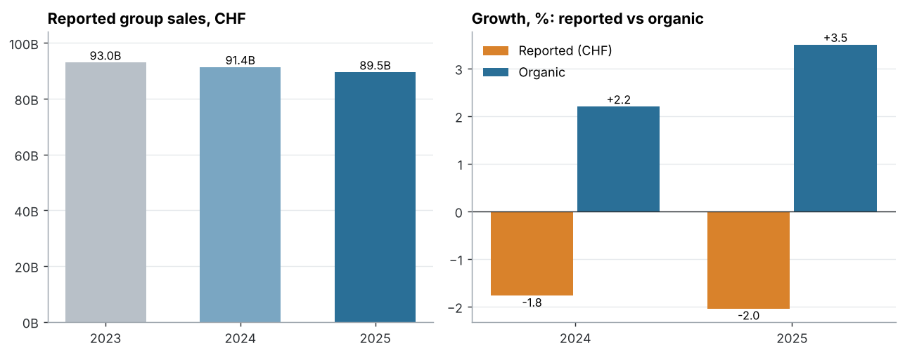
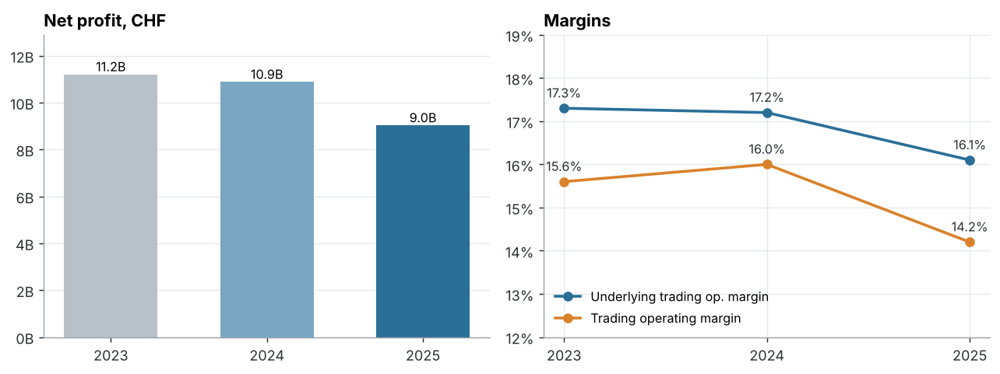
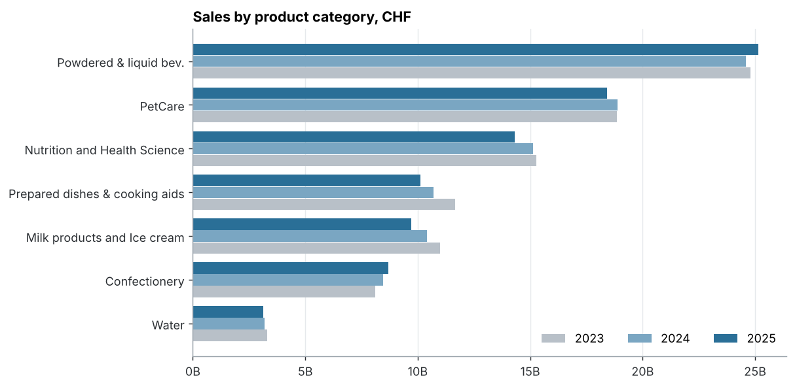
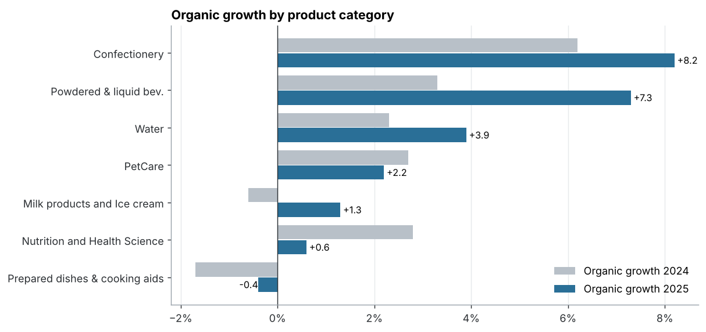
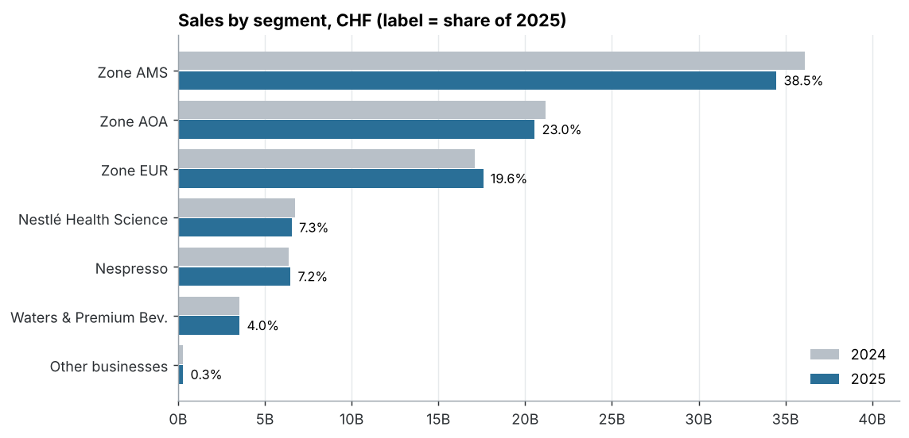
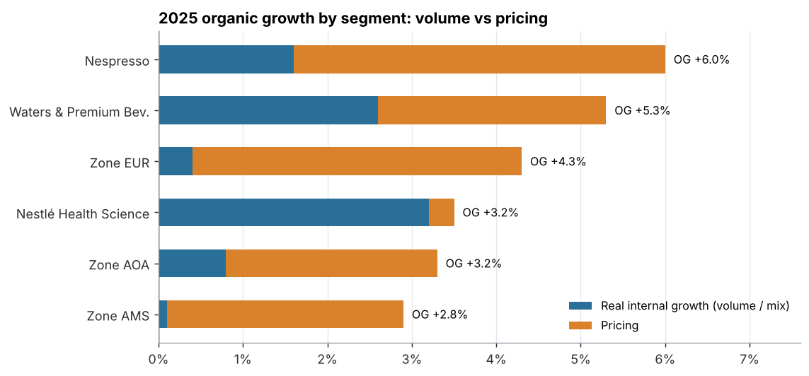

# Nestlé Reported Sales Analysis, 2023–2025

Analysis of **real figures published by Nestlé** (annual reviews and segment restatements): sales by product category and operating segment, organic growth split into volume and pricing, profitability and seasonality. Includes a tidy dataset with sources, reusable Python functions, a Streamlit app and a Power BI build kit.

## Data
All values are in CHF millions and transcribed from Nestlé documents (full list with links: [`data/sources.csv`](data/sources.csv)):

| ID | Document | Used for |
|---|---|---|
| S1 | [Annual Review 2024](https://www.nestle.com/sites/default/files/2025-02/annual-review-2024-en.pdf) | FY2023 and FY2024 sales, profit, EPS; zones; product categories |
| S2 | [2024 operating segments restated](https://www.nestle.com/sites/default/files/2025-03/nestle-group-restatements-2024.pdf) | 2024 Q1/H1/9M/FY by segment (2025 structure) and by product; 2024 growth by segment |
| S3 | [2025 restatements document](https://www.nestle.com/sites/default/files/2026-03/nestle-group-restatements-2025.pdf) | 2025 Q1/H1/9M/FY as originally published, by segment and product |
| S4 | [Annual Review 2025](https://www.nestle.com/sites/default/files/2026-02/annual-review-2025-en.pdf) | FY2025 group results, growth by segment and product |

| File | Content |
|---|---|
| `product_annual.csv` | 7 product categories, FY2023–2025 |
| `product_quarterly.csv`, `segment_quarterly.csv` | standalone quarters 2024–2025 (Q1 reported; Q2–Q4 **derived** from cumulative H1 / 9M / FY) |
| `segment_annual.csv` | 7 segments in the 2025 structure, FY2024–2025 |
| `zone_legacy_annual.csv` | older zone structure, FY2023–2024 (the only segment view that includes 2023) |
| `growth.csv` | organic growth, real internal growth (RIG) and pricing |
| `financials.csv` | group sales, operating profit, margins, net profit, EPS |

**Limitations (read before comparing numbers)**
- Public reports are aggregated and annual/cumulative. Monthly sell-in/sell-out by product and region is not published, so **no machine-learning sell-in/sell-out forecast is possible with this data**; the FY2026 chart is only a sensitivity table.
- Segments are comparable only for 2024–2025. 2023 exists only in the older zone structure. Nestlé Health Science, Nespresso and Other businesses are the same in both.
- Nestlé later re-cut 2025 again (Health Science merged into the Zones; products regrouped into Coffee, Petcare, Nutrition, Food & Snacks, Waters & Premium Beverages). No 2023/2024 comparatives for that view were found, so it is not used.
- 2023 "Other businesses" (CHF 283M) is derived as group sales minus reported segments. Organic growth for 2023 and growth by zone for 2023 were not collected.
- Sales are in CHF; the gap between reported and organic growth contains currency translation and portfolio changes, which these sources do not split.
- `src/build_dataset.py` asserts that products and segments sum to the published group total for every year and period.

## Key insights
| Topic | Finding |
|---|---|
| Reported vs organic | Sales CHF 93.0B (2023) → 91.4B (−1.8%) → 89.5B (−2.0%), while organic growth was +2.2% and +3.5%. Gap ≈ −4.0 pp and −5.5 pp (currency and portfolio) |
| Price-led growth | Pricing was 2.8 of 3.5 pp organic growth in 2025 (1.5 of 2.2 pp in 2024). Real internal growth (volume/mix) was 0.8% in both years |
| Profitability | Underlying trading operating margin 17.3% → 17.2% → 16.1%. Net profit CHF 11.2B → 9.0B (−19%). Basic EPS CHF 4.24 → 3.51 |
| Products | Powdered and Liquid Beverages are largest (CHF 25.1B, 28.1% of 2025 sales), then PetCare (20.6%) and Nutrition and Health Science (16.0%) |
| Fastest growing categories | Confectionery (+8.2% organic) and Powdered and Liquid Beverages (+7.3%) in 2025 |
| Weakest categories in CHF | Prepared dishes and cooking aids (−13.3% vs 2023) and Milk products and Ice cream (−11.7%), mostly currency and portfolio effects (organic growth was close to zero) |
| PetCare | Volume-driven: 2025 RIG +2.6% vs organic +2.2% (negative price/mix) |
| Segments | Zone AMS is largest (38.5% of 2025 sales). Fastest organic growth: Nespresso (+6.0%), then Waters & Premium Beverages (+5.3%) and Zone EUR (+4.3%) |
| Seasonality | Group sales are evenly spread over quarters (Q4 26.4%, Q2 24.2%), but Confectionery has 30% of its sales in Q4 and Water 29% in Q2 |

Auto-generated list: [`reports/insights.md`](reports/insights.md).

| | |
|---|---|
|  |  |
|  |  |
|  |  |

## Repository structure
```
├── data/                 # tidy CSVs + sources.csv
├── src/
│   ├── build_dataset.py  # transcribed report figures -> CSVs, with reconciliation checks
│   ├── data_loader.py    # load_all(), check_reconciliation()
│   ├── insights.py       # analysis functions and auto-generated findings
│   ├── plots.py          # matplotlib figures
│   └── powerbi_export.py # tables for Power BI
├── main.py               # runs everything
├── app.py                # Streamlit dashboard
├── powerbi/              # data/, measures.dax, nestle_theme.json, DASHBOARD_GUIDE.md
├── reports/              # figures, summary CSVs, insights.md
└── tests/
```

## Run
```bash
pip install -r requirements.txt
python -m src.build_dataset   # rebuild CSVs (optional, they are committed)
python main.py                # checks, figures, summary tables, Power BI tables
streamlit run app.py          # interactive app
pytest -q
```

## Power BI
Load the CSVs from `powerbi/data/`, create the relationships and measures from [`powerbi/measures.dax`](powerbi/measures.dax) and follow [`powerbi/DASHBOARD_GUIDE.md`](powerbi/DASHBOARD_GUIDE.md). Add your `.pbix` and screenshots to the `powerbi/` folder.

## Next steps
- Add 2023 quarterly data and 2023 organic growth from the 2023 annual report and half-year reports.
- Add peers (Unilever, Danone, Mondelez) for benchmarking.
- Add monthly sell-in/sell-out data if you obtain it, and reuse the ML forecasting approach.

Stack: Python · pandas · Matplotlib · Streamlit · Power BI (DAX)
